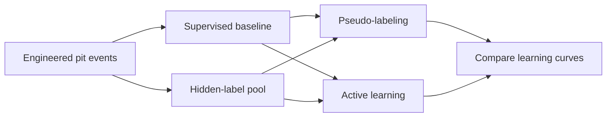
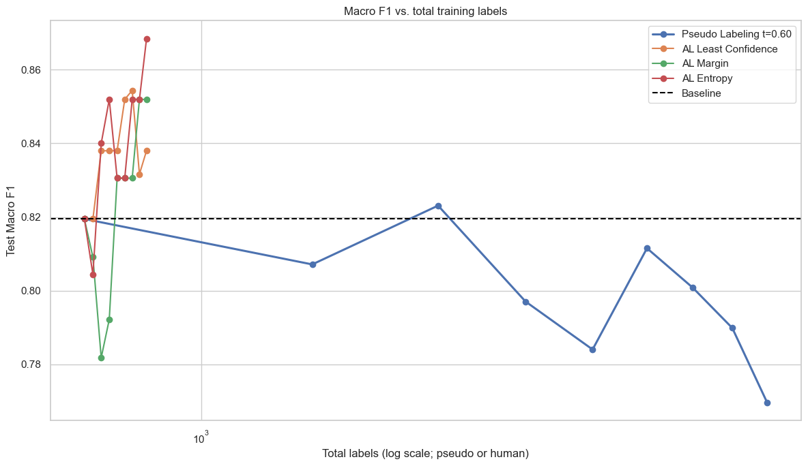
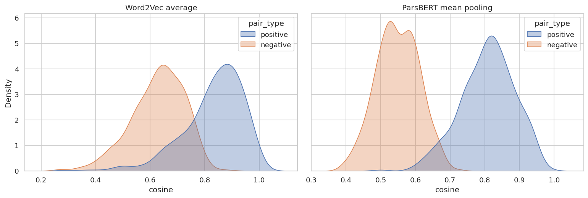
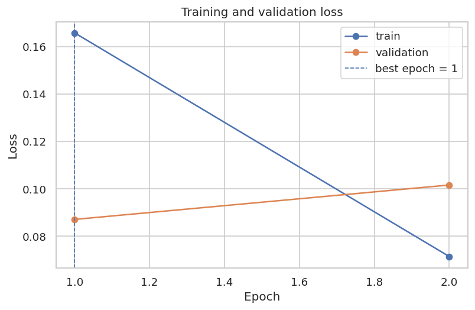
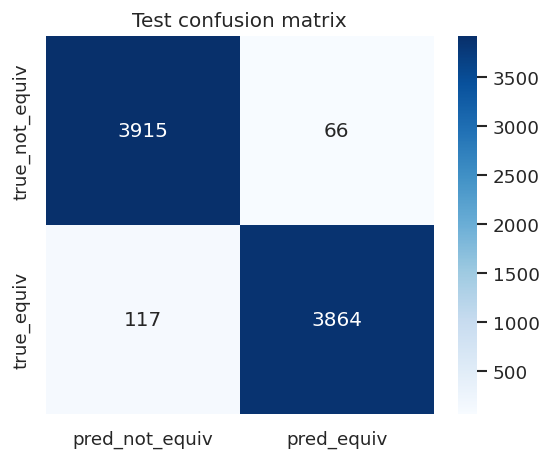
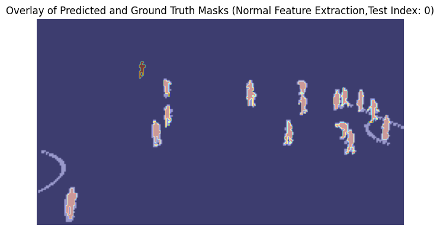
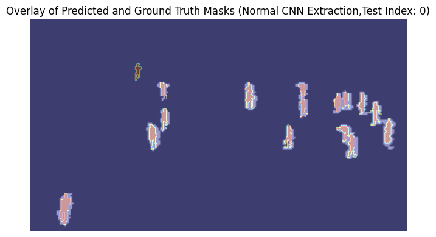

# Learning with Limited Supervision

### F1 strategy · Persian semantic equivalence · LLM evaluation · Image segmentation


Four notebook experiments explore how models learn from scarce labels, handle changes in language, simulate missing knowledge, and segment images without supervised mask training. Developed for **Introduction to Data Science — Assignment 5**, the project connects data preparation, model comparison, and error analysis across tabular ML, Persian NLP, language models, and computer vision.

**Start with the results:**

| Experiment | What was implemented | Recorded outcome |
| :--- | :--- | :--- |
| [🏎️ F1 pit strategy](Task1/Task1.ipynb) | Feature engineering, pseudo-labeling, and active learning | Entropy sampling: **0.8684 macro F1**, versus 0.8195 baseline |
| [💬 Persian equivalence](Task2/Task2.ipynb) | Word2Vec/ParsBERT comparison and partial fine-tuning | **0.9770 macro F1** on 7,962 test pairs |
| [🧠 Knowledge-gap simulation](Task3/Task3.ipynb) | Structured knowledge-gap prompts and failure analysis | Strategy A: **87.5%** pilot agreement with expected naive answers |
| [⚽ Player segmentation](Task4/Task4.ipynb) | Pixel clustering with handcrafted and pretrained features | Handcrafted pipeline: **0.6667 Dice / 0.5002 IoU** on three images |

These are separate tasks with different evaluation protocols; their metrics are not directly comparable. All results below come from committed notebook outputs or CSV exports.

[Motivation](#motivation) · [Results](#results) · [Technology](#technology) · [Run the notebooks](#usage) · [Engineering lessons](#lessons)

<a id="motivation"></a>
## 🎯 Motivation

Useful labels can be expensive, surface wording can hide shared meaning, and a model's confidence can exceed its reliability. The four experiments investigate these problems through concrete questions:

- Can a small number of informative labels outperform thousands of model-generated labels?
- Can contextual representations recognize equivalent formal and informal Persian sentences?
- Can an LLM answer as someone who lacks specific scientific concepts?
- How far can clustering go toward separating football players from the background?

The [assignment brief](CA5.pdf) provides the original requirements. The notebooks contain the implementations, saved plots, and written analyses.

<a id="results"></a>
## 📊 Experiments & results

### 1. F1 pit-strategy classification

[Explore Task 1 →](Task1/Task1.ipynb)

Eight relational F1 tables are joined into **8,360 pit-stop events from 2014–2024**. Explicit rules assign four strategy classes: Standard, Undercut, Emergency, and Overcut. A stratified split retains **836 labeled events** and hides labels for **7,524 events**; the labeled subset is further divided into **668 training / 84 validation / 84 test** examples.

The pipeline engineers stint age, approximate gaps, recent pace, competitive pressure, and historical stint extension. Previous-round standings and prior-race stint statistics reduce look-ahead in those features. Median imputation, one-hot encoding, scaling, and class balancing are fitted within scikit-learn pipelines. Stop duration and the safety-car proxy are excluded from model inputs because they directly participate in label generation.



**Supervised model selection — validation set**

| Model | Accuracy | Macro F1 |
| :--- | ---: | ---: |
| Logistic Regression | 0.7619 | 0.7025 |
| Random Forest | 0.8333 | 0.7948 |
| **Gradient Boosting** | **0.9286** | **0.9019** |

**Learning-strategy comparison — the same 84-event test set**

| Gradient Boosting variant | Training examples | Accuracy | Macro F1 |
| :--- | :--- | ---: | ---: |
| Supervised baseline | 668 rule-labeled | 0.8810 | 0.8195 |
| Pseudo-labeling, threshold 0.60, round 2 | 668 + 1,600 pseudo-labels | 0.8810 | 0.8231 |
| Pseudo-labeling, threshold 0.60, round 8 | 668 + 6,400 pseudo-labels | 0.8214 | 0.7697 |
| Active learning: least confidence, round 8 | 668 + 160 oracle labels | 0.8929 | 0.8380 |
| Active learning: margin, round 8 | 668 + 160 oracle labels | 0.9048 | 0.8519 |
| **Active learning: entropy, round 8** | **668 + 160 oracle labels** | **0.9167** | **0.8684** |



**Finding:** entropy sampling improves macro F1 by **0.0489** over the baseline. It reaches 0.8400 after just 40 additional oracle labels, exceeding the peak pseudo-labeling score after 1,600 additions. The later pseudo-labeling decline is consistent with error reinforcement; more self-generated labels did not reliably improve this run.

<details>
<summary><strong>Threshold sensitivity and class-level analysis</strong></summary>

All four confidence thresholds reach 0.8231 macro F1 at round 2. Their final results differ:

| Pseudo-label threshold | Round-8 macro F1 |
| :--- | ---: |
| 0.55 | 0.7891 |
| 0.60 | 0.7697 |
| 0.75 | 0.8096 |
| 0.85 | 0.7697 |

The baseline's per-class F1 is **0.9273 Standard**, **0.9091 Undercut**, **0.7273 Emergency**, and **0.7143 Overcut**. Stint age, pressure, and lap-time delta have the largest Gradient Boosting feature importances. Mean one-vs-rest AUC is 0.9775 for the baseline, 0.9812 for the selected pseudo-labeling model, and 0.9818 for entropy active learning.

</details>

**Evaluation scope:** the active-learning oracle reveals existing heuristic labels; no human annotation campaign is recorded. The test set contains only nine Emergency and five Overcut events. Although the baseline is selected on validation, the notebook selects the best pseudo-labeling threshold/round and active-learning round using test scores, so those comparisons are exploratory. Random event splits, completed pit-lap measurements, and race distance derived from final results also limit claims about future-race or live pre-stop prediction.

### 2. Semantic equivalence in formal and informal Persian

[Explore Task 2 →](Task2/Task2.ipynb)

The ParsMap workbook contains **40,018 aligned sentence pairs**. The notebook analyzes vocabulary, sentence length, and WordPiece token inflation, then compares Word2Vec with ParsBERT (`HooshvareLab/bert-fa-base-uncased`). The classification task asks whether two sentences preserve meaning across a change in register.

**Embedding comparison — 500 aligned pairs and their randomly mismatched controls**

| Representation | Aligned mean cosine | Negative mean cosine | Cosine ROC-AUC |
| :--- | ---: | ---: | ---: |
| Averaged Word2Vec, 200-dimensional Skip-Gram | 0.8323 | 0.6283 | 0.9191 |
| **ParsBERT, attention-mask mean pooling** | **0.8080** | **0.5485** | **0.9944** |



**Finding:** ParsBERT separates aligned and mismatched pairs more clearly, despite a lower average positive cosine. Separation between distributions matters more than the absolute similarity scale. This is an embedding diagnostic; Word2Vec is trained on the integrated corpus, so it is separate from the held-out classifier evaluation below. Values here follow executed outputs, which differ slightly from the notebook's Word2Vec narrative.

**Supervised sequence-pair classifier**

- Removes duplicate/repeated sentences before splitting and asserts that sentence sets are disjoint across train, validation, and test.
- Creates balanced random negatives **within each split**, retaining 39,809 positive pairs before negative construction.
- Fits **1,000 balanced training examples** using the final ParsBERT encoder block and classification head: **4.35% of parameters trainable**.
- Uses AdamW, linear warmup/decay, gradient clipping, and the checkpoint with the lowest validation loss.

| Test examples | Accuracy | Macro precision | Macro recall | Macro F1 |
| ---: | ---: | ---: | ---: | ---: |
| 7,962 | 0.9770 | 0.9771 | 0.9770 | **0.9770** |

<details>
<summary><strong>Training curves, confusion matrix, and error interpretation</strong></summary>



Training loss falls from **0.1658 to 0.0715**, while validation loss rises from **0.0871 to 0.1016**. The notebook restores **epoch 1** before testing, avoiding the poorer validation checkpoint.



The notebook examines true/false positives and negatives. Missed equivalences include compressed colloquial forms and low lexical overlap; false positives illustrate possible topical shortcuts. PCA and t-SNE plots provide additional views of 30 aligned sentence pairs.

</details>

**Evaluation scope:** negatives are random mismatches and are often topically easy. These scores do not establish robustness to closely related but contradictory sentences. Full-model fine-tuning is configurable, but the saved result is from partial fine-tuning.

### 3. Simulating human knowledge gaps with LLMs

[Explore Task 3 →](Task3/Task3.ipynb) · [Inspect exported evidence →](Task3/Excel/)

The pipeline enriches **100 OpenBookQA questions** with subject/difficulty labels and three ranked prerequisite concepts. It compares two prompts while withholding **k = 1, 2, or 3 concepts**: Strategy A asks for everyday intuitions from someone who never learned them; Strategy B asks how a knowledge gap shapes a plausible answer.

An **8-question × 3-level × 2-strategy pilot** yields 48 responses. Strategy A is then applied to 30 additional questions, producing 90 more responses.

| Pilot prompt | Expected-naive agreement | Gold-answer agreement | Lexical leakage flags at k = 1 / 2 / 3 |
| :--- | ---: | ---: | :--- |
| **Strategy A** | **87.5%** | 95.8% | 37.5% / 50.0% / 37.5% |
| Strategy B | 25.0% | 29.2% | 75.0% / 87.5% / 87.5% |

**Finding:** A better matches the reference naive answers, but its high gold-answer agreement shows why ordinary QA accuracy is insufficient to judge knowledge-gap simulation. In the combined 114-response Strategy A analysis, 92 responses match expected naive answers, and the weighted confidence–agreement calibration gap is **0.117** toward overconfidence.

The implementation includes **Pydantic schemas, JSON repair, concurrent requests, retries, model fallback, and disk caching**. Recorded model usage includes `gemma-4-31b-it` and `gemini-3.1-flash-lite`; these are notebook run identifiers, not a controlled comparison between model families.

**Evaluation scope:** references combine manually specified examples with LLM-generated expectations, rather than observed student responses. Leakage is a lexical-overlap flag, not proof of semantic leakage. Gold and naive answers can coincide, so gold agreement alone does not prove simulation failure. Varying k tests prompt behavior; it does not remove knowledge from model weights.

### 4. Football-player segmentation through clustering

[Explore Task 4 →](Task4/Task4.ipynb)

The notebook explores **K-means, HDBSCAN, and DBSCAN** on downsampled football images. Handcrafted features include color, position, edges, and texture experiments; the evaluated DBSCAN branch uses color, position, and Sobel edges, excluding LBP texture. Cluster-size filtering, dilation, connected components, and shape constraints produce binary player masks and centroids.

A second branch extracts pretrained **HRNet-W18** features, adds position, and reduces **66 dimensions to 12 with PCA at 95% retained variance**, before DBSCAN and the same postprocessing. A ResNet-50 option exists in code; no separate ResNet score is reported.

| Evaluated pipeline | Mean Dice ↑ | Mean IoU ↑ |
| :--- | ---: | ---: |
| **Handcrafted features + DBSCAN + postprocessing** | **0.6667** | **0.5002** |
| HRNet features + PCA + DBSCAN + postprocessing | 0.6221 | 0.4517 |

| Handcrafted pipeline | HRNet pipeline |
| :---: | :---: |
|  |  |

**Finding:** the simpler feature pipeline scores higher on this run. The overlays show differences in player coverage and background artifacts; pretrained features do not automatically improve the final masks under the selected preprocessing and clustering settings.

**Evaluation scope:** scores are averages over **three images at 240 × 135 pixels**, with COCO masks used for evaluation. K-means and HDBSCAN have exploratory plots, but no final Dice/IoU comparison. The two scored pipelines also use different DBSCAN settings, so this is a pipeline comparison rather than an isolated feature ablation.

<a id="technology"></a>
## 🛠️ Technologies & demonstrated skills

| Area | Tools used | Concrete work |
| :--- | :--- | :--- |
| Data preparation | Python, NumPy, pandas, SciPy | Relational joins, missing-value handling, distribution checks, Persian normalization |
| Classical ML | scikit-learn | Pipelines, class weighting, pseudo-labeling, uncertainty sampling, clustering, PCA/t-SNE |
| NLP & deep learning | PyTorch, Transformers, Gensim | Skip-Gram embeddings, masked pooling, sequence-pair tokenization, partial fine-tuning |
| LLM workflows | LangChain, Google GenAI integration, Hugging Face Datasets, Pydantic, json-repair | Structured prompts, validation, caching, retries, failure and calibration analysis |
| Computer vision | OpenCV, scikit-image, timm, pycocotools | Edge/texture features, pretrained feature maps, morphology, COCO masks, Dice/IoU |
| Experiment reporting | Jupyter, Matplotlib, seaborn | Learning curves, confusion matrices, ROC curves, similarity distributions, mask overlays |

## 🗂️ Repository map

```text
.
├── Task1/
│   ├── Task1.ipynb                    # F1 feature engineering and learning experiments
│   ├── data/raw/                      # Eight relational F1 CSV tables
│   ├── labeled.csv                   # 836 events with strategy labels
│   └── unlabeled.csv                 # 7,524 events without strategy labels
├── Task2/
│   ├── Task2.ipynb                    # Persian EDA, embeddings, and classifier
│   └── trainset_40k_onlySent.xlsx     # ParsMap sentence pairs
├── Task3/
│   ├── Task3.ipynb                    # OpenBookQA knowledge-gap simulation
│   └── Excel/                        # Nine CSV exports, including failure analysis
├── Task4/
│   └── Task4.ipynb                    # Clustering-based player segmentation
├── assets/readme/                    # Unmodified figures extracted from notebook outputs
├── CA5.pdf                           # Assignment specification
└── README.md
```

<a id="usage"></a>
## ⚙️ Run the notebooks

**For a quick review, open the notebook links above:** saved outputs can be inspected without training models or making API calls. The notebooks are independent; each should run top to bottom in its own kernel.

### Local setup

Use **Python 3.11** to align with the recorded Task 1/2 kernel metadata. From the repository root:

```bash
python -m venv .venv
```

Activate with `.venv\Scripts\Activate.ps1` in Windows PowerShell, or `source .venv/bin/activate` on macOS/Linux. Then install the shared dependencies:

```bash
python -m pip install jupyterlab numpy pandas scipy matplotlib seaborn scikit-learn
```

Install only the additional packages needed for the notebook you plan to run:

```bash
# Task 2: Persian NLP
python -m pip install torch transformers gensim openpyxl

# Task 3: API-backed LLM experiments
python -m pip install datasets langchain-google-genai langchain-core pydantic json-repair

# Task 4: computer vision
python -m pip install torch torchvision timm opencv-python scikit-image pycocotools hdbscan pillow
```

Start Jupyter from the task directory so relative data paths resolve correctly. For example:

```bash
cd Task2
python -m jupyterlab Task2.ipynb
```

Use the matching directory and notebook name for another task. Select the Python environment where the packages were installed, then run cells in order.

### Data, downloads, and outputs

| Task | Before running | What to expect |
| :--- | :--- | :--- |
| **1** | Required raw CSVs are included. | Rebuilds features and overwrites `Task1/labeled.csv` and `Task1/unlabeled.csv`. A fallback downloader runs only if raw files are missing. |
| **2** | Keep the included workbook beside the notebook. Internet is needed for the first ParsBERT download. | CUDA is used when available, otherwise CPU. Default training uses 1,000 examples and one trainable encoder block. Creates `task2_outputs/environment.csv`; the best model state is retained in memory, not shipped as a checkpoint. |
| **3** | Supply a Google AI Studio API key through the notebook's hidden prompt, with access/quota for its configured models. | Downloads OpenBookQA, makes API calls, and writes `.task3_cache/` plus CSVs in the working directory. Existing submitted CSVs are in `Task3/Excel/`. Model availability and API responses can affect reruns. |
| **4** | Obtain the football-player dataset referenced in [the assignment, page 27](CA5.pdf#page=27). Images and annotations are **not included**. | With `Task4` as the working directory, provide `content/images/` and `content/annotations/instances_default.json`. Pretrained weights download on first use. The saved configuration processes the first three sorted images. |

**Reproducibility:** no dependency lockfile is committed. The Task 2 output records Python 3.11.4, PyTorch 2.7.0+cu128, Transformers 5.13.1, pandas 2.2.3, scikit-learn 1.6.1, and Gensim 4.4.0. The commands above cover imported dependencies, but are not a verified recreation of that environment. Seeds are set in Tasks 1–3; multithreaded Word2Vec, API responses, and Task 4's unseeded silhouette subsampling can vary.

<a id="lessons"></a>
## 🧩 Engineering decisions & lessons

| Challenge | Implemented approach | Evidence from the experiments |
| :--- | :--- | :--- |
| Scarce, imbalanced labels | Class balancing and uncertainty-based queries | Entropy sampling gains more than adding thousands of pseudo-labels in the recorded F1 run. |
| Leakage through repeated text | Remove repeated sentences, split first, then build negatives | Explicit assertions verify no sentence overlap between classifier splits. |
| Fine-tuning cost and overfitting | Train the last encoder block/head and restore the best validation state | Only 4.35% of parameters are updated; epoch 1 generalizes better than epoch 2 on validation. |
| Fragile API output and service failures | Schema validation, JSON repair, retries, fallback, and caching | The notebook records successful outputs, failures/retries, and cache hits. |
| Expensive pixel clustering | Downsample images, sample silhouette evaluation, and compress CNN features | The vision experiment clusters 97,200 pixels and reduces CNN feature dimensionality before DBSCAN. |

These implementations demonstrate practical experiment design, feature engineering, model evaluation, and inspection of failure cases. Parameter sweeps and method comparisons are documented above; they should not be read as controlled component-removal ablations.

## 🔭 Future improvements

- **F1:** select thresholds and stopping rounds on validation, reserve an untouched race/season-based test set, and audit all features for pre-stop availability.
- **Persian NLP:** add topic-matched hard negatives, spelling-noise tests, and a controlled partial-versus-full fine-tuning comparison.
- **LLM evaluation:** compare against real student responses and manually reviewed semantic leakage labels; track the served model for each exported response.
- **Segmentation:** evaluate more images, standardize BGR/RGB handling before pretrained inference, and isolate feature/PCA/postprocessing effects with controlled ablations.
- **Reproducibility:** pin environments, document external dataset setup, and export trained checkpoints and machine-readable metric summaries.

<sub>Figures in this README are copied unchanged from the committed notebook outputs. Results describe the saved experiments, not newly executed training runs.</sub>
